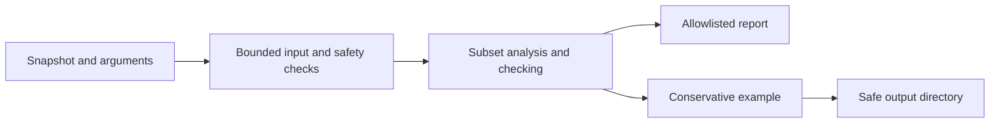

# Architecture

The CLI coordinates input, analysis, rendering, and opt-in artifact writes. Runtime has no network access or subprocess use. Reports use fixed vocabulary; artifacts contain necessary identifiers. File checks and atomic renames reduce risk but do not make multi-file writes transactional.
